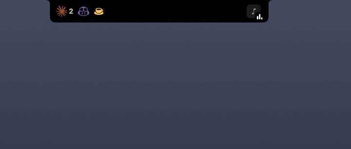

# Visor

[](https://github.com/tailamphat/visor/releases/latest)
[](https://github.com/tailamphat/visor/actions/workflows/ci.yml)

[](#install)
[](LICENSE)

A small, fast macOS notch app for people who work with AI agents. Hover the notch to open it.



**Website:** https://tailamphat.github.io/visor/ (try the notch in your browser).

Native Swift (AppKit + SwiftUI), no web view. Everything is event-driven, and looping animations run as Core Animation layers, so Visor uses ~0% CPU and ~50 MB at rest.

## Features

Short list below; [docs/features.md](docs/features.md) has the full details of each feature.

### Agents

- **Sessions**: every running Claude Code, Copilot CLI and Antigravity CLI session, grouped by agent, with what it's doing now ("Bash: npm test") and which are waiting for you or done. Codex CLI, OpenCode and Gemini CLI sessions show too, read from their own files (no hooks, no approvals).
  - Context ring around each Claude Code session's icon, amber with the percent from 80%.
  - Subagents: "Waiting on 3 helpers" and a list of each helper's task, type and current tool.
- **MCP**: one line under the sessions ("MCP 4 · figma failed 3x in web-shop") opens a list of every MCP server, the agents that use it, its state and its most called tools.
- **Approvals**: Allow / Deny / Always allow from the notch (Return / A / Esc). Claude Code and Copilot CLI.
- **Questions**: when Claude Code asks a multiple-choice question, a blue "?" shows; click the row to jump to its terminal.
- **Office**: the Agents tab as a room where each session is a little person at work. Worlds: Night Studio, Galaxy (Star Wars) and Starfleet (Star Trek).
- **Turn summary**: when an agent finishes, open the notch for time taken, files changed, lines, commands, tests, and View diff.
- **Clash warning**: the notch peeks when two agents edit the same file within ten minutes.
- **Provider status**: Claude and GitHub incidents show as a peek and a red or amber dot.
- **Release radar**: when an AI tool on your Mac (Claude Code, Copilot CLI, Codex CLI, Gemini CLI, OpenCode) has a newer release, a peek shows once and a "What's new" card with the top changes stays in Usage until you dismiss it. Checked every 6 hours.

### Usage

| Item | Shows | For |
|---|---|---|
| **Limits** | % used, reset time, pace ("Runs out in ~1h 15m"); time left in the closed notch when under an hour | Claude, Copilot (every `gh` account, `*.ghe.com` included), OpenCode Go, Antigravity |
| **Spend** | Cost at API prices: today, 7 days, 30 days | Claude Code, OpenCode |
| **Tokens** | Tokens by model and day, kept in `tokens.json` | Claude Code, Copilot CLI, OpenCode, Antigravity CLI, Codex CLI, Gemini CLI |
| **Connected accounts** | Sign-in status per tool, a button to fix it, hide and reorder | All of the above |

### Everyday

- **Clipboard**: everything you copy, newest first. ⌘⇧V opens it from anywhere; search, pin, paste. Secrets from password managers are never kept, and history stays on this Mac.
- **Music**: what Spotify, Apple Music or a browser tab is playing, with artwork, progress and controls. Any browser with the **Visor Media** extension.
- **Keep awake**: the cup in the Agents tab keeps your Mac from sleeping. On, Auto (only while an agent works) or Off.

### Plugins

- **Plugins**: small Lua files that add a section, a badge or a peek to the notch. Three examples ship in [`Plugins/`](Plugins): **github** (failed Actions runs and PRs waiting for your review), **focus** (a focus timer) and **hello**. See [Writing Visor plugins](docs/plugins.md).

## Requirements

- macOS 14 or later, on a Mac with a notch.
- At least one agent: Claude Code, Copilot CLI, Antigravity CLI (`agy`), Codex CLI, Gemini CLI or OpenCode.
- To build from source: the Command Line Tools (Xcode not required).

## Getting started

### Install

```sh
brew install --cask tailamphat/tap/visor
```

Visor is signed ad hoc, not notarized; the cask clears the quarantine flag for you. If you install it another way and macOS says "Visor is damaged", run `xattr -dr com.apple.quarantine /Applications/Visor.app`.

### Connect your agents

1. Launch Visor and choose **Connect your agents** in the notch (or the menu bar icon).
2. Hover the notch to open it. Click the icons in its header to switch tabs.
3. macOS asks for Accessibility (pasting, some shortcuts) and Automation (music controls) the first time you use those features.

### Shortcuts

| Shortcut | Where | Does |
|---|---|---|
| ⌘⇧V | Anywhere | Open the clipboard |
| ↑ / ↓, Return | Clipboard | Pick and paste into the app you were in |
| ⌥Return | Clipboard | Paste as plain text |
| ⌘P | Clipboard | Pin or unpin |
| ⌫ | Clipboard | Delete |
| ⌘Z | Clipboard | Undo a delete |
| ⌘C | Clipboard | Copy without pasting |
| Esc | Clipboard | Clear the search, or close |
| Return / A / Esc | Approval card | Allow / Always allow / Deny |

### Updates and uninstall

Visor checks for updates every 6 hours, downloads in the background and installs when it quits. **Restart to Update** in the menu installs now; **Install Updates Automatically** turns this off. Visor was called Notchboard; on first launch it moves Notchboard's files and hooks.

```sh
brew uninstall --cask visor
```

## Privacy

- **Stays on your Mac**: agent events (sent over a local socket), transcripts, clipboard history and music.
- **Network**: only the usage APIs of the tools you connect (`api.anthropic.com`, GitHub's Copilot API, `opencode.ai`), the Claude and GitHub status pages, and the release radar's public feeds (`registry.npmjs.org`, `formulae.brew.sh`, `api.github.com`, no sign-in).
- **Sign-ins**: read from the keychain or `gh` when needed, never stored, written or refreshed.
- **Writes**: a hook entry in each connected agent's settings (with a backup) and `~/Library/Application Support/Visor/`. The hook always exits 0, so agents never wait on Visor.

Every source, endpoint and refresh interval: [docs/how-it-works.md](docs/how-it-works.md).

## Contributing

```sh
./scripts/bundle.sh --open   # build build/Visor.app and launch it
scripts/test.sh              # unit tests (use this, not swift test)
```

- Test first; commits follow [Conventional Commits](https://www.conventionalcommits.org), e.g. `feat(usage): show Copilot premium requests`.
- [docs/architecture.md](docs/architecture.md): module map, data flows and recipes for adding features.
- [CLAUDE.md](CLAUDE.md): project rules, toolchain notes, releasing and testing without a mouse.
- [docs/plugins.md](docs/plugins.md): writing plugins.

## License

MIT
