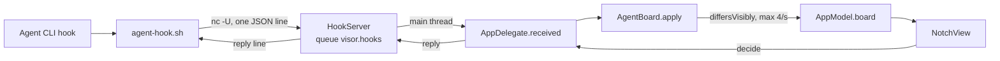

# Visor architecture

Visor is a menu bar app with no Dock icon that draws a black panel over the MacBook notch. Services (hook server, usage, music, clipboard, plugins, status, keep awake) run on their own queues and write results into one `@Observable` `AppModel` on the main thread. SwiftUI views in the notch read only from `AppModel`. Logic that can be tested without AppKit lives in `VisorCore`; the app target wires it to macOS. [CLAUDE.md](../CLAUDE.md) holds the hard rules (test first, balanced header, performance); this page is the map.

## Module map

| Target | Owns |
|---|---|
| `Sources/VisorCore` | Pure logic, no AppKit: hook parsing (`HookMessage`), agent state (`AgentBoard`, file-read sessions in `FileAgents`), approvals (`ApprovalRequest`, `ApprovalRoute`, `ApprovalCall`, `ApprovalRelease`, `TerminalAnswer`, `ApprovalLog`), hook settings JSON (`HookSettings`), usage parsers (`AntigravityUsage`, `CopilotUsage`, `OpenCodeUsage`, `PlanLimits.swift`), spend and tokens (`TranscriptUsage`, `TokenLedger`, `Pricing`), notch sizing (`NotchEars`, `NotchQuotaSummary`), the limit handoff (`HandoffPlanner`: from current limits, pace and sessions only, whether a Claude limit runs out soon, which agents have room, and the clipboard note: project, task, files, test outcome, never commands or tool input), clipboard history (`ClipHistory`), browser media (`BrowserMedia`, `BrowserBridge`), MCP health (`MCPConfig`: configured server names only, never values, from each agent's config files; `MCPStats`: calls, recent failures and top tools per server from `PostToolUse`/`PostToolUseFailure` tool names, capped; `MCPSummary`: the Agents-tab line and rows, no dates or counts), the Lua runtime (`Plugins/LuaPlugin.swift`), design tokens (`DesignTokens`, `DesignScale`) and shared component measurements (`DesignComponents`). |
| `Sources/Visor` | The app. One folder per feature, below. |
| `Sources/VisorBridge` | `visor-bridge`, the native messaging host browsers start for the extension. |
| `Sources/CLua` | Vendored Lua 5.4.7 plus `clua.c`. |
| `Tests/VisorCoreTests` | Swift Testing suites for `VisorCore` only. |

App folders:

- `App`: `AppDelegate` (creates every service, wires `AppModel` closures, routes hook events), `AppDelegate+Menu` (menu bar menu), `AppModel` (all view state, plus `Tab`, `NowPlaying`, `Peek`), `Intro`, `UpdateFeed` (Sparkle).
- `Notch`: `NotchWindow.swift` (`NotchPanel`, `NotchController`: placement, hover, click-through, keyboard), `NotchView.swift` (`NotchLayout`, `CollapsedView`, `ExpandedView`, header), `Theme`, `LayerAnimations`.
- `Agents`: `HookServer`, `HookInstaller` (writes `agent-hook.sh` and each CLI's hook config), `FileAgentsService` (Codex CLI, OpenCode and Gemini CLI, read-only), `MCPService` (MCP health: `MCPConfig` read on queue `visor.mcp` only when the session folders change or, when the Agents list appears, a config file's `MCPConfigStamp` changed; hook calls into `MCPStats`; `model.mcp` set only when the `MCPSummary` changes; debug builds read `VISOR_MCP_HOME`), `MCPView` (the line under the sessions and its server list), `ProcessTree`, `AgentsView`, `ApprovalView`, `HelpersView`, `StatusService` (status pages), `AwakeService`.
- `Usage`: `UsageService` plus one extension per provider (`UsageService+Claude`, `+Copilot`, `+Antigravity`, `+OpenCode`, `+Tokens`), views (`UsageView`, `ProviderBlocks`, `TokensView` with `UsageBar`, `AccountsView`, `SpendView`, `LimitMeter`), and the release radar: `RadarService` (every 6 h on queue `visor.radar`, first check 2 min after launch or 6 h after the saved last one; `--version` only when the binary's stamp changed; the folders holding offered tools' links and their binaries are watched (`DispatchSource`, 2 s settle), and a change reruns only `--version` so a caught-up card shows "Updated" for 3 s and goes (`RadarState.confirm`/`cards`); formulae from a tap other than Homebrew core (`BrewReceipt`) are skipped; GETs only `registry.npmjs.org`, `formulae.brew.sh`, `api.github.com` through `ReleaseFetcher`, which refuses any other redirect target and cuts answers at 2 MB; log in `~/Library/Logs/Visor/radar.log`) with `RadarCard` (the "What's new" section). Its logic is `RadarState` and `ReleaseRadar` in VisorCore.
- `Music`: `MusicService`, `BrowserBridgeServer`, `MusicView`.
- `Clipboard`, `Bar` (tab hidden for now), `Office` (pixel office for the Agents tab), `Plugins` (`PluginService`, `PluginRunner`, `PluginsView`).
- `DesignSystem/`: `Tokens.swift` (`DS`: the design tokens as SwiftUI fonts, radii, fills, spacing and sizes, read from VisorCore's `DesignTokens`); `SharedComponents.swift` (`CardButton`, `DismissButton`, `Badge`, `SectionHeader`, `.bannerCard`, `.compactBanner`, `.dsShadow`).
- `Shared`: small views. `Support`: `Shell`, `UnixSocketListener`, `AudioOutputWatcher`, `HotKey`, `MediaKeys`.

## Data flows

### Agent events

1. The CLI runs `~/Library/Application Support/Visor/agent-hook.sh <Event> [provider]` (`HookInstaller.script`). It wraps stdin as `{"event","provider","pid","hpid","raw"}` and sends it to `hook.sock` with `/usr/bin/nc`.
2. `HookServer` (`UnixSocketListener` on queue `visor.hooks`) reads one line and calls `HookMessage.parse`, which maps Copilot and Antigravity events and fields onto Claude Code's names (`copilotPayload`, `antigravityPayload`).
3. `HookServer.onMessage` hops to the main thread: `AppDelegate.received(_:_:)`.
4. `received` sets `message.pid` to `ProcessTree.agentAncestor`, calls `agents.apply(message)` on its private `AgentBoard` and `mcp.record(message)` (MCP calls), looks up the host app, releases moot approvals (`ApprovalRelease.after`), then `publishAgents()`.
5. `publishAgents` copies `agents` into `model.board` only if `differsVisibly(from:)`, at most every 0.25 s, then saves sessions and updates keep awake.
6. A `Stop` produces `agents.finished(message)`, shown as a `Peek.done` via `show(_:for:)`.
6b. For Claude Code, `readContextSoon` (queue `visor.context`, after `PostToolUse`, `Stop`, `SessionStart`, `UserPromptSubmit`) reads the context from the transcript's tail and the session's cost from only its newly appended bytes (`SessionCostReader`, including `<session>/subagents/*.jsonl`), then `agents.setContext` and `agents.setCost`; tallies of ended sessions are dropped on the prune tick.
6c. `noteStuck` feeds every hook event to `StuckWatch` (VisorCore, per session and subagent, O(1) per event): the same call failing 3 times in a row (reads neutral) or run 4 times with no edit between (a subagent's edit counts for the session) and its last run not a success; Antigravity, which reports no outcome, needs 5 back-to-back runs. Calls are told apart by command, file, pattern or URL, else the whole input. It peeks once per call (`Peek.stuck`) and `refreshStuck` publishes `model.stuck` (the Agents tab's Stuck? card and the card outline) only when `generation` moves. It is re-derived from events only and clears on the call succeeding, a different call, an edit, `UserPromptSubmit`, `SessionStart` (not `compact`), `Stop`, `SessionEnd`, `SubagentStop`, or the agent's exit (`forget(keeping:)` on the prune tick); a 15 min timeout is a fallback with one scheduled wake-up. Command and error text stay in memory only. Debug builds: `{"event":"_stuck","raw":{"press":"ignore|open"}}` presses the first card's Ignore or Open.
6d. Limit handoff: `watchHandoff` observes `model.plan`, `model.quotas` (Copilot and OpenCode Go refresh with the plan every 2 min), `model.antigravityUpdated`, `model.unmeteredAgents` (Codex CLI, Gemini CLI, OpenCode found at launch) and `model.board`, and on each change `refreshHandoff` runs `HandoffPlanner.decide` on current readings and the live sessions (`agents`, newer than the notch copy) (`HandoffInputs` lists an Antigravity reading older than 15 min without a percent) and passes it through `HandoffGate`, which drops a window put off with Later and peeks once per window (`Peek.handoff`). `model.handoff` (the Agents tab's card above Stuck) is exactly that result: no stored shown state, so it clears when the limit resets (one wake-up at the reset, or when an Antigravity reading turns stale), the pace recovers, extra usage has room, another agent works in the project or the Claude session ends, and its peek goes with it. Copy rebuilds the note from the live session and writes it to `NSPasteboard.general` with `org.nspasteboard.ConcealedType` and `TransientType`, which clipboard history skips; nothing is typed anywhere. Debug builds: `{"event":"_handoff","raw":{"used":85,"runsOutIn":1200,"resetsIn":2400,"others":[{"agent":"Copilot CLI","left":45}]}}` fakes a Claude limit and other quotas for the handoff only (`resetsIn` below 0: reset), `"clear":true` drops it, `"press":"later|copy"` presses the card's buttons.
7. Codex CLI, OpenCode and Gemini CLI send no hooks: `FileAgentsService` (queue `visor.file-agents`) reads their rollouts, database and chats when a watched file changes or on the 5 s prune tick, parses with `CodexRollout` and `OpenCodeSessions` (`FileAgents.swift`) and `GeminiChat` (`GeminiSessions.swift`), and `AppDelegate.fileAgentsRead` calls `agents.sync(agent:scanned:live:)`, which replaces that agent's sessions and returns finished turns for the peek.

### Approvals

1. `ApprovalRequest(message)` is non-nil for a `PermissionRequest`. `HookServer` keeps the socket open in `pending` and lets go after 108 s.
2. `ApprovalRoute.of(_:inNotch:rules:)` picks `.terminal` (reply nil now), `.allow` (a saved Copilot rule) or `.notch` (append to `model.approvals`, expand).
3. `ApprovalView` calls `model.decide`, which is `AppDelegate.decide`: `hooks.reply(request, decision)` writes `request.reply(decision)` and closes the socket.
4. `HookServer.watchHooks` polls 4 times a second while anything is pending: hook pid gone means `.endedInTerminal`; the Bash command running under the agent means `.allowedInTerminal`. Either fires `onApprovalGone`, which `AppDelegate.approvalGone` handles.
5. `ApprovalRelease.after(message)` lets go of cards a session's later event makes moot (`hooks.releaseApprovals`, `.movedOn(event)`): `UserPromptSubmit`, `Stop`, `SessionEnd` and an idle `Notification` release all of them; `PostToolUse`/`PostToolUseFailure` release the oldest card for the same `ApprovalCall` (tool, canonical `tool_input`, `agent_id`); with no exact match, a tool other than Bash takes the oldest card for that tool and agent (an edit changed in the IDE before accepting). So a subagent's call, or a parallel Bash call, never clears the card. Matching runs on the hooks queue, only when the session holds an approval (`releaseApprovals(after:)`).
6. `ApprovalLogger` (queue `visor.approvals.log`) writes `ApprovalLog.line` to `~/Library/Logs/Visor/approvals.log` (debug: `approvals-debug.log`, restarted past 256 KB) when a request is routed and when it ends: provider, project folder, tool and outcome only, never the command or input.

### Usage providers

1. `UsageService.start` sets `model.<x>Installed`, then schedules timers: transcripts and token logs every 15 s, plan and OpenCode every 120 s.
2. Each `refresh<X>()` lives in `UsageService+<X>.swift`. It guards on `model.shows(provider)`, a `fetching<X>` flag and an attempt timestamp (the cache), runs on `work` (queue `visor.usage`), parses with a `VisorCore` type and hops back to main.
3. On main it assigns the model only when the value changed (`if model.antigravity != usage`), sets `<x>Error` and `<x>Updated`, and calls `checkLimitsBack()` for the "limit is back" card.
4. `AppModel` property observers record readings into `usageHistory` for burn-rate forecasts; `AppModel.quotas` builds the closed notch's quotas through `NotchQuotaSummary.make`.
5. Opening the Usage tab calls `refreshIfStale()` (from `notch.onExpand` and the tab button).

### Clipboard

`ClipboardService` reads `NSPasteboard.changeCount` every second and on app switch, filters with `ClipHistory.shouldRecord`, writes images off main, then sets `model.clips` and saves `clipboard.json` (debounced). Paste and keys go through `AppDelegate.clipboardKey` and `model.pasteClip`.

### Music

- Spotify and Music: distributed notifications trigger `refreshNative`, which runs AppleScript on queue `visor.music`.
- Browsers: `AudioOutputWatcher` reports sound; `audioChanged` finds audible browsers; `refreshBrowsers` scripts only those. A slow timer runs only while something plays.
- Extension: `visor-bridge` connects to `browser.sock`; `BrowserBridgeServer` parses lines with `BrowserBridge.tabs` and calls `onTabs`; commands go back with `send(_:tab:browser:)`.
- `MusicService.show()` picks one `NowPlaying` (extension, browser, native) and sets `model.nowPlaying` if it differs.

### Plugins

`PluginService.reload()` reads each folder's `plugin.json` (`PluginManifest.parse`), creates a `PluginRunner` per enabled plugin and watches files with `DispatchSourceFileSystemObject`. Each runner owns a serial queue `visor.plugin.<id>`, a `LuaPlugin`, and `DispatchSourceTimer`s for `visor.every`. It implements `PluginHost` (requests, secrets, store, log, output) and publishes back through `PluginService.update(_:_:)` on main into `model.plugins`.

Plugin views use the design system: `PluginNode` (VisorCore) carries palette names (`PluginColor`), type steps (`PluginTypeStep`, `PluginWeight`) and the shared components (`.banner`, `.badge`, `.header`); `PluginsView` draws every piece with `DS` tokens, `PluginPieces` measurements and `CardButton`, `Badge`, `SectionHeader`, `.bannerCard`, `DismissButton`.

## State, threading, persistence

- `AppModel` is `@MainActor @Observable`. View-only state (hover, selections, measured heights) lives there too, since `@State` isn't available.
- Actions flow up through closures on `AppModel` (`decide`, `musicCommand`, `refreshPlan`, `installHooks`), set in `applicationDidFinishLaunching`.
- Off main: `visor.hooks`, `visor.usage`, `visor.music`, `visor.browser-bridge`, `visor.status`, `visor.plugin.<id>`, plus `DispatchQueue.global` for file writes.
- Throttling: `publishAgents` (0.25 s), `saveAgentsSoon` (1 s), `showBusyIfSlow` in `PluginRunner` (spinner only after 0.3 s), equality checks before every model write.
- Files in `~/Library/Application Support/Visor/`: `sessions.json` (`sessions-debug.json`), `copilot-rules.json`, `clipboard.json` and `Clips/`, `Plugins/`, `PluginData/<id>.json`, `tokens.json` (`tokens-debug.json`, the token ledger), `release-radar.json` (`release-radar-debug.json`: offers, dismissed and announced versions, last check, version cache), the sockets. Settings are in `UserDefaults`.

## Notch window and layout

- `NotchController` places one fixed-size `NotchPanel` (`NotchLayout.windowSize`) and toggles click-through; it opens on hover via event monitors.
- `NotchLayout.size(for:)` decides the visible shape for every state; add a branch there for any new panel height.
- Closed: `CollapsedView` measures each side into `model.leftEarContent` and `model.rightEarContent`; `NotchEars.width(content:)` adds `NotchEars.inset`. `NotchLayout.showsEars` decides whether sides show at all.
- Open: `ExpandedView.header` draws `[.agents, .usage, .music]` left and `[.clipboard, .plugins]` plus `AgentSlot` right, each slot `NotchEars.musicTab`. The body is a `switch model.tab`, with approvals, welcome, summary and limit-back taking over first.

## Design system

Every colour, type size, radius, fill strength, spacing and fixed size comes from one set of tokens. Office pixel art and agent brand marks (`AgentStyle`) keep their own palettes.

- Values: `Sources/VisorCore/DesignTokens.swift`, one `public static let name: Type = literal` per line inside `enum Palette`, `TypeScale`, `Radius`, `Fill`, `Space`, `Size` (colours as `UInt32` hex). The website's token generator reads this file as text, so keep that line shape. `DesignScale` holds the same values as tables (`typeScale`, `radius`, `fill`, `space`, `size`, `palette`, and `all`) plus `snap`.
- SwiftUI: `Sources/Visor/DesignSystem/Tokens.swift` (`DS.font(.sm, .semibold)`, `DS.Radius.md`, `DS.Fill.subtle`, `DS.Space.sm`, `DS.Size.button`). `Theme` stays the entry point for colours and reads them from `DesignTokens.Palette`.
- Website: `scripts/site-tokens.sh` turns the tokens into `--v-*` CSS variables (`--v-accent`, `--v-type-sm`, `--v-radius-md`, `--v-fill-subtle`, `--v-space-sm`, `--v-size-button`, and for each colour its solid fill, text and held fill `--v-solid-accent`, `--v-on-accent`, `--v-held-accent`), kept between `/* tokens:begin */` and `/* tokens:end */` at the top of `docs/index.html`'s style; the notch mocks use `var(--v-*)`. After changing a token run `scripts/site-tokens.sh --write`; `scripts/check.sh` fails when the block is stale or an added site line uses a raw hex equal to a palette token.
- Design system document: [`docs/design-system.html`](design-system.html) shows every token and shared component live, with their SwiftUI and `visor.ui` code. It carries four generated blocks: the same tokens block, a `components` block copied from `docs/index.html`'s `.v-*` classes (between `/* components:begin */` and `/* components:end */` there), a `measures` block (`--v-c-<component>-<name>`) from `DesignComponents.swift` and `Plugins/PluginDesign.swift` (`PluginPieces`, and the `PluginColor` names), and a `contrast` block (`--v-k-<fill>`: solid fill, text colour and ratio for each row of `DesignContrast.fills`) for its Contrast table. The page draws its swatches, scales and measure table from those blocks. After changing a token, a component measure or the site's component classes, run `scripts/site-tokens.sh --write` and `scripts/site-tokens.sh --write docs/design-system.html`; `scripts/check.sh` fails when any block is stale or missing.

| Group | Steps |
|---|---|
| Type (pt) | xs 9, sm 10, base 11, md 12, lg 13, xl 15, display 26; weights regular, medium, semibold, bold (light only with display) |
| Radius | xs 3, sm 5, md 9, lg 12 |
| Fill (white opacity) | faint .05, subtle .08, medium .12, strong .16, heavy .25 |
| Space | none 0, hair 1, xxs 2, xs 4, sm 6, md 8, lg 10, xl 12, xxl 16, xxxl 20 |
| Size | bar 4, cardInset 10, button 18, iconLarge 20 (SF Symbol icons, not text) |

Moving an old literal onto the scale: `DesignScale.snap(value, to:)` picks the nearest step, a tie goes to the smaller step (nothing grows inside a fixed-height row), and values past the ends clamp. So 10.5 pt is `sm`, radius 10 is `md`, fill .1 is `subtle`, padding 9 is `md`.

### Shared components

Measurements in `Sources/VisorCore/DesignComponents.swift` (tested: every value is a token step except the named constants `Banner.strokeOpacity`, `CardButton.pressedOpacity`, `SectionHeader.tracking`, the music `Backdrop` strengths, `Artwork.iconRatio`, `Banner.compactHeight`, `KeyCap.opacity`, `Popover.fill`, the `Shadow` values and the intro's `IntroLight` strengths and corners; `DesignComponents.measurements` lists them all); SwiftUI views in `Sources/Visor/DesignSystem/SharedComponents.swift`. Use them instead of a view's own button, badge or card chrome.

| Component | Use | Looks |
|---|---|---|
| `Button("Open") {}.buttonStyle(CardButton(.primary))` | the main action in a card | 18 pt, radius sm, base semibold, padding md, the accent as a solid fill (`solidFill`: darkened just enough for white text), white text (black on a light tint) |
| `CardButton(.secondary)` | the other card actions (Later, Ignore) | same, white fill medium, dims to .75 while held; a held primary moves its fill away from its text (`pressedFill`, `DesignContrast.pressed`) so its contrast never drops |
| `DismissButton(help: "Close") { }` | the "x" on a card | 18 pt square, xmark at sm bold, muted |
| `.bannerCard(tint:height:)` | a tinted card over a list (Stuck?, handoff) | cardInset on all sides, radius md, tint at fill subtle, tint stroke .35 |
| `.compactBanner(tint:height:)` | a one-line banner (Music hints, the clash banner) | the banner card at a fixed height (26 pt default), cardInset at the sides only |
| `KeyCap(key: "esc")` | the key that presses a button | sm semibold, radius xs, foreground at fill strong, dimmed to .8 |
| `.dsShadow(.panel / .artwork / .toast / .lifted, shown:)` | drop shadows (open panel, Music artwork, Clipboard toast, dragged row) | black at `DesignComponents.Shadow` strengths, blurs and offsets |
| `Badge("Stuck?", .solid(tint))`, `Badge("v2", .neutral)` | a small capsule label | sm semibold, padding sm x hair, the tint as a solid fill with its text colour, or white fill medium |
| `SectionHeader("Plans")` | the uppercase title over a group | sm semibold, uppercase, tracking 0.6, muted |
| `Artwork(image:size:corner:)` | album art (closed notch, Music) | rounded square; without art a muted note at .45 of its size on raised |

Contrast contract (`Sources/VisorCore/DesignContrast.swift`, tested in `Design contrast`): text below `TypeScale.xl` needs 4.5:1 against its fill, larger text and icons or UI marks 3:1 (WCAG 2). A colour drawn as a solid fill follows `DesignContrast.solid`: white text, the fill darkened toward black by the smallest 0.5% step that reaches 4.5:1 (same hue); black text on the fill as it is for the light fills (`blackTextFills`: warning, awake, mint, onPace, stuck) and wherever white would need more than `maxDarkening` (27%), past which a colour reads as another (orange as brown). The pairing table is `DesignContrast.fills`; translucent tints are taken over the black surface first. CardButton primary, Badge solid and PillButton fill with `tint.solidFill` and draw their text in `tint.onColour` (`DesignSystem/Tokens.swift`, resolved once per colour by `SolidFill`), so no caller passes a text colour for a tinted fill. Text in a colour on black (accent text, meters) uses the colour itself; only solid fills are darkened. `DesignContrast.pairs` lists every pair the components produce and the test fails on any below its minimum. A plugin's manifest accent is passed through `DesignContrast.readableAccent` at load (lightened until it reads as text on the notch and in every banner). The website gets the same values as generated `--v-solid-<name>`, `--v-on-<name>` and `--v-held-<name>` tokens (`.v-btn.primary` and `.v-badge.solid` use `--solid-tint`, `--on-tint` and `--held-tint`, set by each `.tint-*` class). A new fill colour goes in `fills`; a new component that puts text on a fill adds its pairs.

A banner's height is `DesignComponents.Banner.height(rows:spacing:)`: fixed-height rows plus gaps inside the inset. To add a component: its measurements as token references in `DesignComponents`, each added to `measurements` (`Design components` tests fail otherwise), then the view in `SharedComponents.swift`, then a row in this table.

Enforced everywhere: `scripts/check.sh` and `DesignAdoptionTests` scan every Swift file under `Sources/Visor` (Plugins included) for literal colours, type sizes, radii and fills (SwiftUI and AppKit/Core Animation spellings; spacing is not checked), with one shared pattern list, `scripts/design-literals.txt`. There is no allowlist of lines; only whole paths are skipped, each with its reason: the design system itself, `Notch/Theme.swift` (the colour entry point; its only literal hexes are the brand marks in `AgentStyle`, tested), `Shared/AgentMark.swift` (brand marks) and the Office pixel-art files (`Office/OfficeArt.swift` holds the room's palette and room-scale label sizes; the office's status bubbles, context bars and hover card take Theme and DS). A value the scale lacks becomes a token or a component measurement, never a literal. The intro's light uses the palette tokens `introGlow`, `introSky`, `introSpark` and `violet` (also the Bar's Shortcuts tile).

## Patterns

- A service is a `@MainActor final class` holding `let model: AppModel`, with `init(model:)` and `start()`. Work runs on a private queue; results come back with `DispatchQueue.main.async { MainActor.assumeIsolated { ... } }` (`UsageService+Antigravity.swift:17`).
- Blocking helpers are `nonisolated static func`, so they can run on the work queue (`fetchAntigravity`).
- Failures are values, not throws to the UI: `Result` or optional, shown as a `<x>Error` string on the model. `try?` is the norm; `NSLog("Visor: ...")` only for startup failures (`AppDelegate.swift:178`).
- A remembered setting is an `AppModel` property initialised from `UserDefaults` with a `didSet` that writes it back (`agentsOffice`, `AppModel.swift`).
- Tests: `@Suite("Plain name")` on a `struct ...Tests`, `@Test func sentenceName()`, `#expect`, `#require`, parameterised `arguments:`; small file-level fixture helpers like `hook(_:_:)` in `AgentTests.swift:6`.

## Recipes

### Add a usage provider

1. `VisorCore`: a `<X>Usage` struct with `static func parse(_ data: Data) -> <X>Usage?`; tests in `UsageTests.swift` (or a new `<X>UsageTests.swift`).
2. `Connections.swift`: add a `ConnectionProvider` case (`title`, `agent`, `signInCommand`) and a `ConnectionState.<x>(...)` factory.
3. `AppModel`: `<x>`, `<x>Error`, `<x>Updated`, `<x>Installed`; extend `hasContent`, `installed`, `connection`. Record into `usageHistory` with a new `UsageKey` if it has limits.
4. `UsageService+<X>.swift`: `refresh<X>()` following the guard, flag, cache, `work.async`, main publish shape. Add it to `start`, `refresh(_:)`, `perform` and `refreshIfStale`.
5. Views: a `<X>Block` in `ProviderBlocks.swift`, a case in `UsageView.section`, a height branch in `NotchLayout.size(for:)`.
6. Closed notch and alerts: `NotchQuotaSummary.make`, `LimitReading.all` (`NotchHelpers.swift`), `AgentLogo.path(for:)`, `AgentStyle.mark`.

### Add a new agent CLI

1. `HookSettings`: event list plus install, uninstall, isInstalled for its config format; test in `AgentTests.swift`.
2. `HookMessage.parse`: a `provider` case with an event map and a payload normalizer to Claude Code field names; test with the `hook(_:provider:...)` helper.
3. `agent-hook.sh` in `HookInstaller.script` if the CLI cannot pass the provider as the second argument (see the Antigravity branch) or needs a printed decision.
4. `HookInstaller`: config path, `has<X>CLI`, `<x>Installed`, `install<X>`, `uninstall<X>`.
5. `AgentBoard.agentName` and the `order` in `activeAgents`; `ProcessTree.agentAncestor` name match; `AgentLogo.path(for:)` and `AgentStyle.mark`.
6. `AppDelegate`: reinstall on launch and in `installHooks`; a menu toggle in `menuNeedsUpdate`. If it can ask approvals, check `ApprovalRequest` and `ApprovalRoute`.

### Add a notch tab or header item

1. Mock it up first. Each side has three `NotchEars.musicTab` slots and all six are used, so a new item swaps one out or adds one on each side.
2. Add a `Tab` case with `symbol`, then place it in `ExpandedView.header`.
3. Add a `case` in `ExpandedView.body` and a height branch in `NotchLayout.size(for:)`.
4. View state goes on `AppModel`; a `_show` tab name works automatically through `Tab(rawValue:)`.

### Add a debug socket message

1. In `AppDelegate.received`, inside the `#if DEBUG` block, add `if message.event == "_name" { ...; return }` with a one-line comment showing the JSON.
2. Read arguments from `message.payload` (the `raw` object).
3. Add it to the CLAUDE.md list. Send it to `hook-debug.sock` only.

### Add a design token

1. Prefer an existing step: `DesignScale.snap` says which one an odd value belongs to.
2. A new value: add a `public static let` line to its group in `DesignTokens.swift` and the matching `Step` in `DesignScale` (`Design tokens/sourceLinesParse` fails if they disagree); keep each scale increasing.
3. Expose it in `DesignSystem/Tokens.swift` (or on `Theme` for a colour views use widely). Required, and only type steps are checked (a debug build asserts `DS.TypeStep` matches `DesignScale.typeScale`): radii, fills, spacing and sizes there are mapped by hand, so check the name on both sides.
4. Update the table in "Design system" above.

### Add a setting to the menu

1. Declare the setting: an `AppModel` property backed by `UserDefaults` with `didSet`, or a static computed property on `AppDelegate` like `approvalsInNotch` when only services read it.
2. In `AppDelegate+Menu.swift`, `menuNeedsUpdate`: `addToggle(to: menu, "Title", on: value, #selector(toggleX))` in the right section.
3. Add `@objc private func toggleX()` that flips the value; any service reacts through a closure such as `awakeChanged`.
