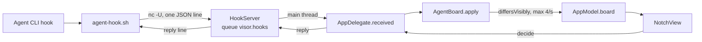

# Visor architecture

Visor is a menu bar app with no Dock icon that draws a black panel over the MacBook notch. Services (hook server, usage, music, clipboard, plugins, status, keep awake) run on their own queues and write results into one `@Observable` `AppModel` on the main thread. SwiftUI views in the notch read only from `AppModel`. Logic that can be tested without AppKit lives in `VisorCore`; the app target wires it to macOS. [CLAUDE.md](../CLAUDE.md) holds the hard rules (test first, balanced header, performance); this page is the map.

## Module map

| Target | Owns |
|---|---|
| `Sources/VisorCore` | Pure logic, no AppKit: hook parsing (`HookMessage`), agent state (`AgentBoard`, file-read sessions in `FileAgents`), approvals (`ApprovalRequest`, `ApprovalRoute`, `ApprovalCall`, `ApprovalRelease`, `TerminalAnswer`, `ApprovalLog`), hook settings JSON (`HookSettings`), usage parsers (`AntigravityUsage`, `CopilotUsage`, `OpenCodeUsage`, `PlanLimits.swift`), spend and tokens (`TranscriptUsage`, `TokenLedger`, `Pricing`), notch sizing (`NotchEars`, `NotchQuotaSummary`), clipboard history (`ClipHistory`), browser media (`BrowserMedia`, `BrowserBridge`), MCP health (`MCPConfig`: configured server names only, never values, from each agent's config files; `MCPStats`: calls, recent failures and top tools per server from `PostToolUse`/`PostToolUseFailure` tool names, capped; `MCPSummary`: the Agents-tab line and rows, no dates or counts), the Lua runtime (`Plugins/LuaPlugin.swift`). |
| `Sources/Visor` | The app. One folder per feature, below. |
| `Sources/VisorBridge` | `visor-bridge`, the native messaging host browsers start for the extension. |
| `Sources/CLua` | Vendored Lua 5.4.7 plus `clua.c`. |
| `Tests/VisorCoreTests` | Swift Testing suites for `VisorCore` only. |

App folders:

- `App`: `AppDelegate` (creates every service, wires `AppModel` closures, routes hook events), `AppDelegate+Menu` (menu bar menu), `AppModel` (all view state, plus `Tab`, `NowPlaying`, `Peek`), `Intro`, `UpdateFeed` (Sparkle).
- `Notch`: `NotchWindow.swift` (`NotchPanel`, `NotchController`: placement, hover, click-through, keyboard), `NotchView.swift` (`NotchLayout`, `CollapsedView`, `ExpandedView`, header), `Theme`, `LayerAnimations`.
- `Agents`: `HookServer`, `HookInstaller` (writes `agent-hook.sh` and each CLI's hook config), `FileAgentsService` (Codex CLI, OpenCode and Gemini CLI, read-only), `MCPService` (MCP health: `MCPConfig` read on queue `visor.mcp` only when the session folders change or, when the Agents list appears, a config file's `MCPConfigStamp` changed; hook calls into `MCPStats`; `model.mcp` set only when the `MCPSummary` changes; debug builds read `VISOR_MCP_HOME`), `MCPView` (the line under the sessions and its server list), `ProcessTree`, `AgentsView`, `ApprovalView`, `HelpersView`, `StatusService` (status pages), `AwakeService`.
- `Usage`: `UsageService` plus one extension per provider (`UsageService+Claude`, `+Copilot`, `+Antigravity`, `+OpenCode`, `+Tokens`), views (`UsageView`, `ProviderBlocks`, `TokensView` with `UsageBar`, `AccountsView`, `SpendView`, `LimitMeter`), and the release radar: `RadarService` (every 6 h on queue `visor.radar`, first check 2 min after launch or 6 h after the saved last one; `--version` only when the binary's stamp changed; the folders holding offered tools' links and their binaries are watched (`DispatchSource`, 2 s settle), and a change reruns only `--version` so a caught-up card shows "Updated" for 3 s and goes (`RadarState.confirm`/`cards`); formulae from a tap other than Homebrew core (`BrewReceipt`) are skipped; GETs only `registry.npmjs.org`, `formulae.brew.sh`, `api.github.com` through `ReleaseFetcher`, which refuses any other redirect target and cuts answers at 2 MB; log in `~/Library/Logs/Visor/radar.log`) with `RadarCard` (the "What's new" section). Its logic is `RadarState` and `ReleaseRadar` in VisorCore.
- `Music`: `MusicService`, `BrowserBridgeServer`, `MusicView`.
- `Clipboard`, `Bar` (tab hidden for now), `Office` (pixel office for the Agents tab), `Plugins` (`PluginService`, `PluginRunner`, `PluginsView`).
- `Shared`: small views. `Support`: `Shell`, `UnixSocketListener`, `AudioOutputWatcher`, `HotKey`, `MediaKeys`.

## Data flows

### Agent events

1. The CLI runs `~/Library/Application Support/Visor/agent-hook.sh <Event> [provider]` (`HookInstaller.script`). It wraps stdin as `{"event","provider","pid","hpid","raw"}` and sends it to `hook.sock` with `/usr/bin/nc`.
2. `HookServer` (`UnixSocketListener` on queue `visor.hooks`) reads one line and calls `HookMessage.parse`, which maps Copilot and Antigravity events and fields onto Claude Code's names (`copilotPayload`, `antigravityPayload`).
3. `HookServer.onMessage` hops to the main thread: `AppDelegate.received(_:_:)`.
4. `received` sets `message.pid` to `ProcessTree.agentAncestor`, calls `agents.apply(message)` on its private `AgentBoard` and `mcp.record(message)` (MCP calls), looks up the host app, releases moot approvals (`ApprovalRelease.after`), then `publishAgents()`.
5. `publishAgents` copies `agents` into `model.board` only if `differsVisibly(from:)`, at most every 0.25 s, then saves sessions and updates keep awake.
6. A `Stop` produces `agents.finished(message)`, shown as a `Peek.done` via `show(_:for:)`.
7. Codex CLI, OpenCode and Gemini CLI send no hooks: `FileAgentsService` (queue `visor.file-agents`) reads their rollouts, database and chats when a watched file changes or on the 5 s prune tick, parses with `CodexRollout` and `OpenCodeSessions` (`FileAgents.swift`) and `GeminiChat` (`GeminiSessions.swift`), and `AppDelegate.fileAgentsRead` calls `agents.sync(agent:scanned:live:)`, which replaces that agent's sessions and returns finished turns for the peek.

### Approvals

1. `ApprovalRequest(message)` is non-nil for a `PermissionRequest`. `HookServer` keeps the socket open in `pending` and lets go after 108 s.
2. `ApprovalRoute.of(_:inNotch:rules:)` picks `.terminal` (reply nil now), `.allow` (a saved Copilot rule) or `.notch` (append to `model.approvals`, expand).
3. `ApprovalView` calls `model.decide`, which is `AppDelegate.decide`: `hooks.reply(request, decision)` writes `request.reply(decision)` and closes the socket.
4. `HookServer.watchHooks` polls 4 times a second while anything is pending: hook pid gone means `.endedInTerminal`; the Bash command running under the agent means `.allowedInTerminal`. Either fires `onApprovalGone`, which `AppDelegate.approvalGone` handles.
5. `ApprovalRelease.after(message)` lets go of cards a session's later event makes moot (`hooks.releaseApprovals`, `.movedOn(event)`): `UserPromptSubmit`, `Stop`, `SessionEnd` and an idle `Notification` release all of them; `PostToolUse`/`PostToolUseFailure` release the oldest card for the same `ApprovalCall` (tool, canonical `tool_input`, `agent_id`); with no exact match, a tool other than Bash takes the oldest card for that tool and agent (an edit changed in the IDE before accepting). So a subagent's call, or a parallel Bash call, never clears the card. Matching runs on the hooks queue, only when the session holds an approval (`releaseApprovals(after:)`).
6. `ApprovalLogger` (queue `visor.approvals.log`) writes `ApprovalLog.line` to `~/Library/Logs/Visor/approvals.log` (debug: `approvals-debug.log`, restarted past 256 KB) when a request is routed and when it ends: provider, project folder, tool and outcome only, never the command or input.

### Usage providers

1. `UsageService.start` sets `model.<x>Installed`, then schedules timers: transcripts and token logs every 15 s, plan and OpenCode every 120 s.
2. Each `refresh<X>()` lives in `UsageService+<X>.swift`. It guards on `model.shows(provider)`, a `fetching<X>` flag and an attempt timestamp (the cache), runs on `work` (queue `visor.usage`), parses with a `VisorCore` type and hops back to main.
3. On main it assigns the model only when the value changed (`if model.antigravity != usage`), sets `<x>Error` and `<x>Updated`, and calls `checkLimitsBack()` for the "limit is back" card.
4. `AppModel` property observers record readings into `usageHistory` for burn-rate forecasts; `AppModel.quotas` builds the closed notch's quotas through `NotchQuotaSummary.make`.
5. Opening the Usage tab calls `refreshIfStale()` (from `notch.onExpand` and the tab button).

### Clipboard

`ClipboardService` reads `NSPasteboard.changeCount` every second and on app switch, filters with `ClipHistory.shouldRecord`, writes images off main, then sets `model.clips` and saves `clipboard.json` (debounced). Paste and keys go through `AppDelegate.clipboardKey` and `model.pasteClip`.

### Music

- Spotify and Music: distributed notifications trigger `refreshNative`, which runs AppleScript on queue `visor.music`.
- Browsers: `AudioOutputWatcher` reports sound; `audioChanged` finds audible browsers; `refreshBrowsers` scripts only those. A slow timer runs only while something plays.
- Extension: `visor-bridge` connects to `browser.sock`; `BrowserBridgeServer` parses lines with `BrowserBridge.tabs` and calls `onTabs`; commands go back with `send(_:tab:browser:)`.
- `MusicService.show()` picks one `NowPlaying` (extension, browser, native) and sets `model.nowPlaying` if it differs.

### Plugins

`PluginService.reload()` reads each folder's `plugin.json` (`PluginManifest.parse`), creates a `PluginRunner` per enabled plugin and watches files with `DispatchSourceFileSystemObject`. Each runner owns a serial queue `visor.plugin.<id>`, a `LuaPlugin`, and `DispatchSourceTimer`s for `visor.every`. It implements `PluginHost` (requests, secrets, store, log, output) and publishes back through `PluginService.update(_:_:)` on main into `model.plugins`.

## State, threading, persistence

- `AppModel` is `@MainActor @Observable`. View-only state (hover, selections, measured heights) lives there too, since `@State` isn't available.
- Actions flow up through closures on `AppModel` (`decide`, `musicCommand`, `refreshPlan`, `installHooks`), set in `applicationDidFinishLaunching`.
- Off main: `visor.hooks`, `visor.usage`, `visor.music`, `visor.browser-bridge`, `visor.status`, `visor.plugin.<id>`, plus `DispatchQueue.global` for file writes.
- Throttling: `publishAgents` (0.25 s), `saveAgentsSoon` (1 s), `showBusyIfSlow` in `PluginRunner` (spinner only after 0.3 s), equality checks before every model write.
- Files in `~/Library/Application Support/Visor/`: `sessions.json` (`sessions-debug.json`), `copilot-rules.json`, `clipboard.json` and `Clips/`, `Plugins/`, `PluginData/<id>.json`, `tokens.json` (`tokens-debug.json`, the token ledger), `release-radar.json` (`release-radar-debug.json`: offers, dismissed and announced versions, last check, version cache), the sockets. Settings are in `UserDefaults`.

## Notch window and layout

- `NotchController` places one fixed-size `NotchPanel` (`NotchLayout.windowSize`) and toggles click-through; it opens on hover via event monitors.
- `NotchLayout.size(for:)` decides the visible shape for every state; add a branch there for any new panel height.
- Closed: `CollapsedView` measures each side into `model.leftEarContent` and `model.rightEarContent`; `NotchEars.width(content:)` adds `NotchEars.inset`. `NotchLayout.showsEars` decides whether sides show at all.
- Open: `ExpandedView.header` draws `[.agents, .usage, .music]` left and `[.clipboard, .plugins]` plus `AgentSlot` right, each slot `NotchEars.musicTab`. The body is a `switch model.tab`, with approvals, welcome, summary and limit-back taking over first.

## Patterns

- A service is a `@MainActor final class` holding `let model: AppModel`, with `init(model:)` and `start()`. Work runs on a private queue; results come back with `DispatchQueue.main.async { MainActor.assumeIsolated { ... } }` (`UsageService+Antigravity.swift:17`).
- Blocking helpers are `nonisolated static func`, so they can run on the work queue (`fetchAntigravity`).
- Failures are values, not throws to the UI: `Result` or optional, shown as a `<x>Error` string on the model. `try?` is the norm; `NSLog("Visor: ...")` only for startup failures (`AppDelegate.swift:178`).
- A remembered setting is an `AppModel` property initialised from `UserDefaults` with a `didSet` that writes it back (`agentsOffice`, `AppModel.swift`).
- Tests: `@Suite("Plain name")` on a `struct ...Tests`, `@Test func sentenceName()`, `#expect`, `#require`, parameterised `arguments:`; small file-level fixture helpers like `hook(_:_:)` in `AgentTests.swift:6`.

## Recipes

### Add a usage provider

1. `VisorCore`: a `<X>Usage` struct with `static func parse(_ data: Data) -> <X>Usage?`; tests in `UsageTests.swift` (or a new `<X>UsageTests.swift`).
2. `Connections.swift`: add a `ConnectionProvider` case (`title`, `agent`, `signInCommand`) and a `ConnectionState.<x>(...)` factory.
3. `AppModel`: `<x>`, `<x>Error`, `<x>Updated`, `<x>Installed`; extend `hasContent`, `installed`, `connection`. Record into `usageHistory` with a new `UsageKey` if it has limits.
4. `UsageService+<X>.swift`: `refresh<X>()` following the guard, flag, cache, `work.async`, main publish shape. Add it to `start`, `refresh(_:)`, `perform` and `refreshIfStale`.
5. Views: a `<X>Block` in `ProviderBlocks.swift`, a case in `UsageView.section`, a height branch in `NotchLayout.size(for:)`.
6. Closed notch and alerts: `NotchQuotaSummary.make`, `LimitReading.all` (`NotchHelpers.swift`), `AgentLogo.path(for:)`, `AgentStyle.mark`.

### Add a new agent CLI

1. `HookSettings`: event list plus install, uninstall, isInstalled for its config format; test in `AgentTests.swift`.
2. `HookMessage.parse`: a `provider` case with an event map and a payload normalizer to Claude Code field names; test with the `hook(_:provider:...)` helper.
3. `agent-hook.sh` in `HookInstaller.script` if the CLI cannot pass the provider as the second argument (see the Antigravity branch) or needs a printed decision.
4. `HookInstaller`: config path, `has<X>CLI`, `<x>Installed`, `install<X>`, `uninstall<X>`.
5. `AgentBoard.agentName` and the `order` in `activeAgents`; `ProcessTree.agentAncestor` name match; `AgentLogo.path(for:)` and `AgentStyle.mark`.
6. `AppDelegate`: reinstall on launch and in `installHooks`; a menu toggle in `menuNeedsUpdate`. If it can ask approvals, check `ApprovalRequest` and `ApprovalRoute`.

### Add a notch tab or header item

1. Mock it up first. Each side has three `NotchEars.musicTab` slots and all six are used, so a new item swaps one out or adds one on each side.
2. Add a `Tab` case with `symbol`, then place it in `ExpandedView.header`.
3. Add a `case` in `ExpandedView.body` and a height branch in `NotchLayout.size(for:)`.
4. View state goes on `AppModel`; a `_show` tab name works automatically through `Tab(rawValue:)`.

### Add a debug socket message

1. In `AppDelegate.received`, inside the `#if DEBUG` block, add `if message.event == "_name" { ...; return }` with a one-line comment showing the JSON.
2. Read arguments from `message.payload` (the `raw` object).
3. Add it to the CLAUDE.md list. Send it to `hook-debug.sock` only.

### Add a setting to the menu

1. Declare the setting: an `AppModel` property backed by `UserDefaults` with `didSet`, or a static computed property on `AppDelegate` like `approvalsInNotch` when only services read it.
2. In `AppDelegate+Menu.swift`, `menuNeedsUpdate`: `addToggle(to: menu, "Title", on: value, #selector(toggleX))` in the right section.
3. Add `@objc private func toggleX()` that flips the value; any service reacts through a closure such as `awakeChanged`.
