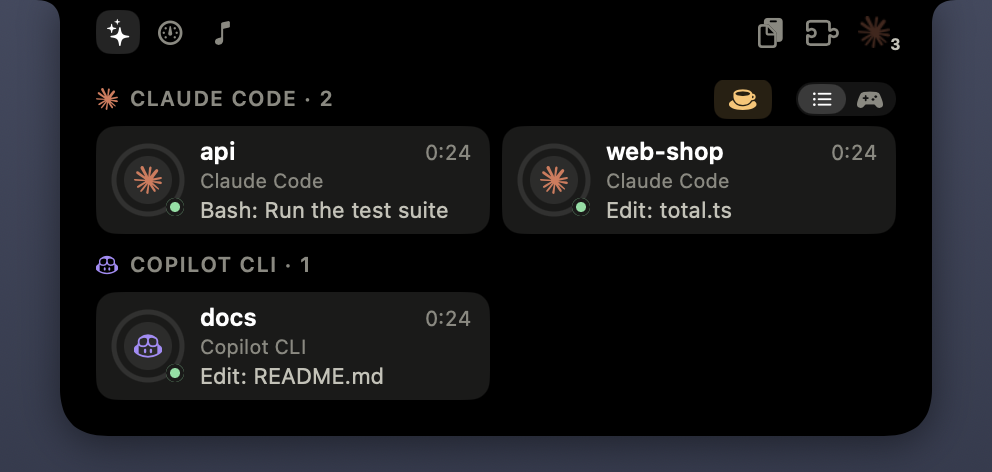
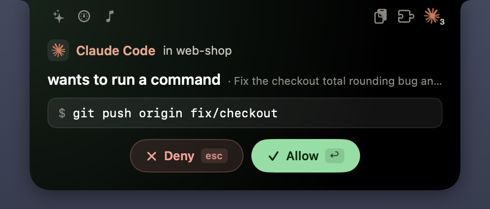
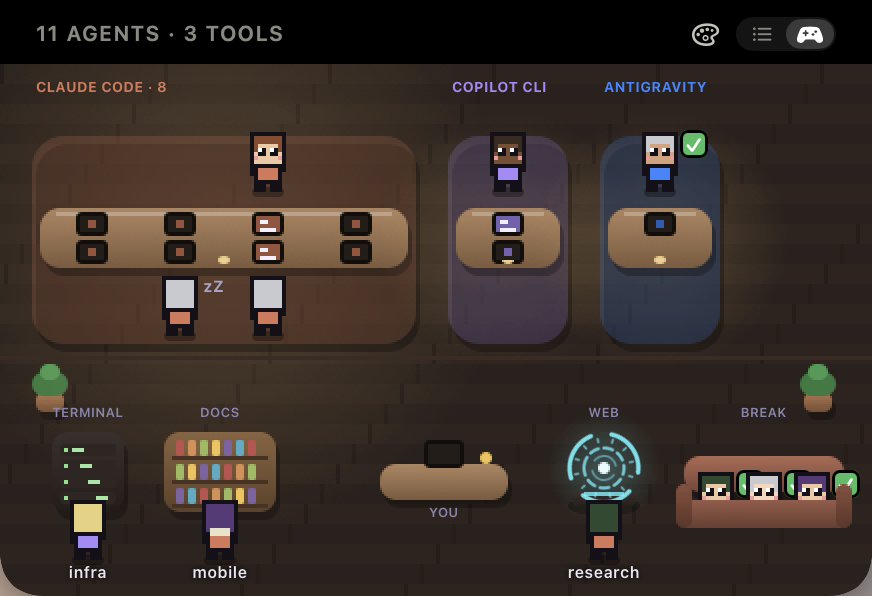
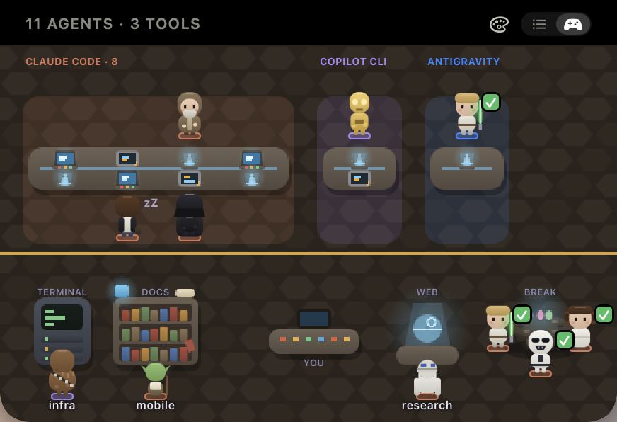
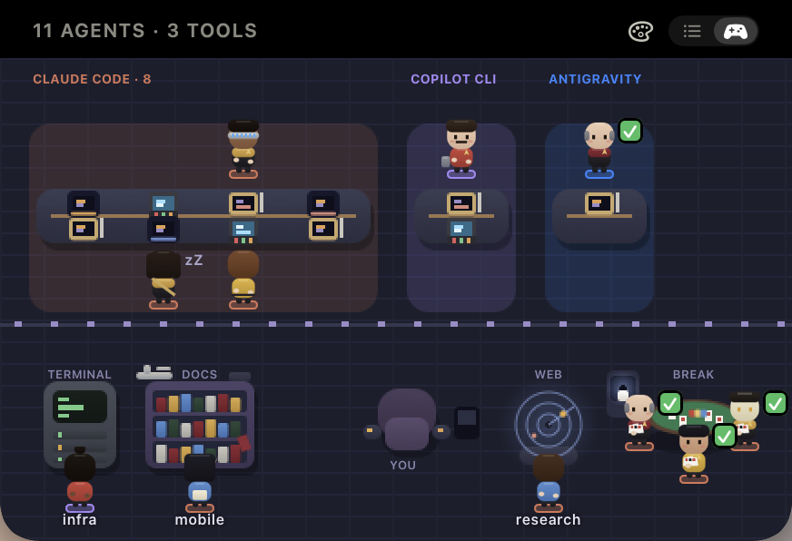
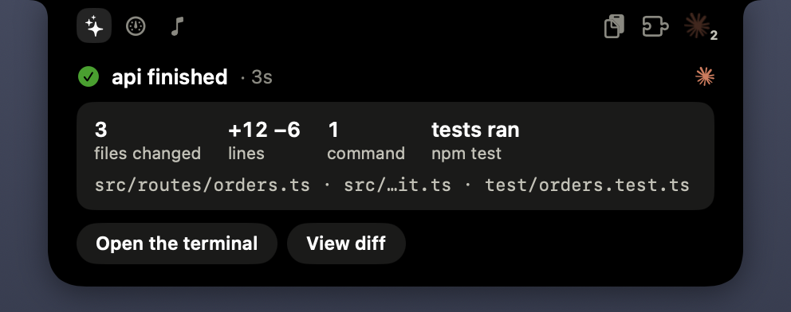
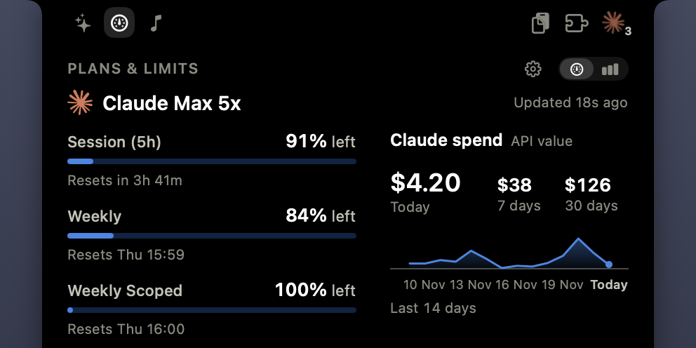
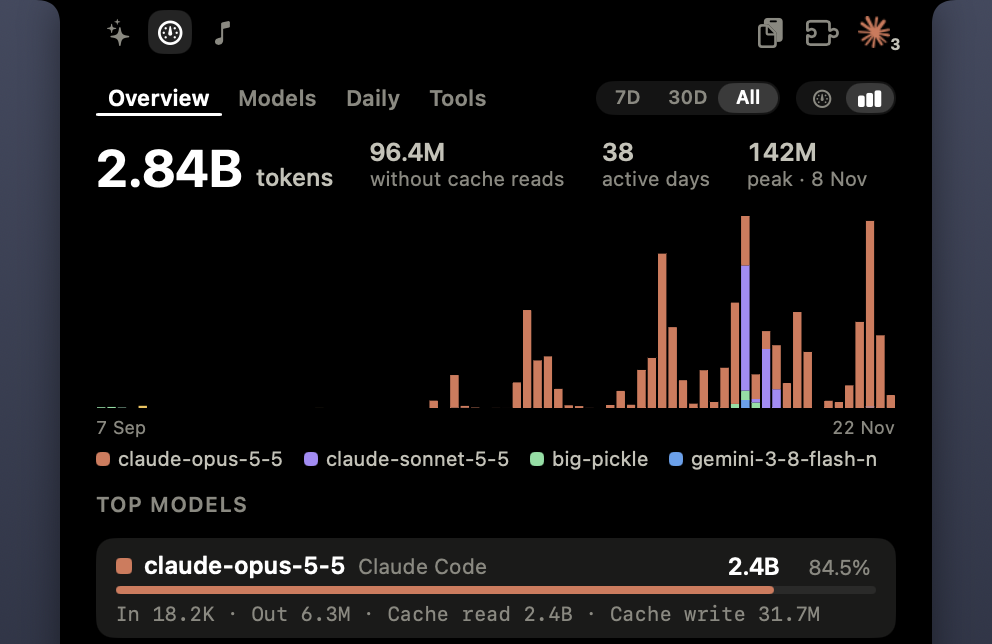
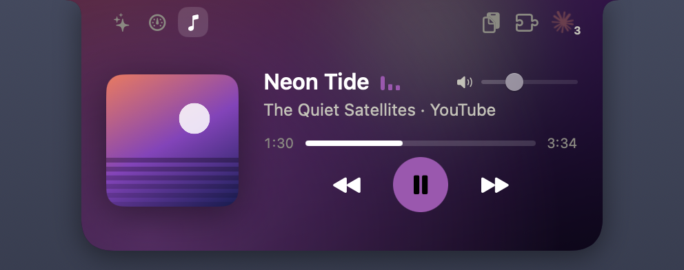

# Visor features

Visor lives in the MacBook notch. Closed, the two sides of the notch show small signs: an agent waiting for you, a limit running low, the song playing. Hover the notch to open it: a panel with a header of tabs (Agents, Usage, Music on the left; Clipboard, Plugins and the agents' badge on the right). The [README](../README.md) has the short list; this page has the details.

Every feature below uses the same labels, in the same order. A label is left out when it has nothing to say.

- **Works with**: which agents, tools or apps it supports.
- **What you see**: what shows in the notch.
- **How to use**: clicks and keys.
- **Settings**: switches that change it.
- **Good to know**: limits and edge cases.
- **How it works**: where the data comes from (each links to its section in [how-it-works.md](how-it-works.md)).

## Contents

- [Agents](#agents): [Sessions](#sessions), [Subagents](#subagents), [Approvals](#approvals), [Questions](#questions), [Office](#office), [Turn summary](#turn-summary), [Clash warning](#clash-warning), [Provider status](#provider-status), [MCP servers](#mcp-servers)
- [Usage](#usage): [Limits](#limits), [Pace](#pace), [Spend](#spend), [Tokens](#tokens), [Connected accounts](#connected-accounts), [Release radar](#release-radar)
- [Everyday](#everyday): [Clipboard](#clipboard), [Music](#music), [Keep awake](#keep-awake)
- [Plugins](#plugins)
- [Closed notch signs](#closed-notch-signs)
- [Menu bar settings](#menu-bar-settings)

## Agents

### Sessions

See every running agent session and what it is doing right now.

- **Works with:** Claude Code, Copilot CLI, Antigravity CLI. Codex CLI, OpenCode and Gemini CLI show too, read-only.
- **What you see:** the Agents tab lists sessions grouped by agent, two to a row, with the current activity ("Bash: npm test", "Edit: Main.swift"), and which ones are waiting for you or have finished. Each Claude Code session has a ring around its icon showing how full its context window is; it turns amber with the percent from 80%, when the session is about to compact.
- **How to use:** click a session to bring its app forward. Connect agents with **Connect your agents** in the notch, or under Agents in the menu bar menu.
- **Good to know:** transcripts don't say whether a session has the 200k or the 1M context window. Visor counts it as 1M once it goes past 200k, or when the `model` setting asks for `[1m]`. Sessions are saved and restored after a restart, minus agents whose process has exited. Codex CLI, OpenCode and Gemini CLI sessions come from their own files: no hooks and no approvals. They show while the agent runs in its folder, or for 30 minutes (working) or 10 minutes (finished) after the file last changed.
- **How it works:** agent hooks send events to a Unix socket owned by Visor. See [Claude Code](how-it-works.md#claude-code-hooks), [Copilot CLI](how-it-works.md#copilot-cli-hooks) and [Antigravity CLI](how-it-works.md#antigravity-cli-hooks) hooks. The context ring reads the last reply in the session's transcript. Codex, OpenCode and Gemini sessions are read from their files, see [Codex CLI, OpenCode and Gemini CLI](how-it-works.md#codex-cli-opencode-and-gemini-cli).

### Subagents

See the helpers a Claude Code session starts, instead of a stream of their tools.

- **Works with:** Claude Code (full list), Copilot CLI (count only, from its task calls).
- **What you see:** the card says "Waiting on 3 helpers". A ⑂ button with the count (9+ past nine) opens a list under the cards: each helper's task, its type and what it is doing now, running ones first, at most six rows and "+n more". In the office, up to three small copies of the agent sit at its side while helpers run ("+n" past that); a helper that finishes hands over a sheet of paper and walks off.
- **How to use:** click the ⑂ button.
- **Good to know:** Visor keeps at most 20 helpers per session (finished ones clear on your next prompt) and redraws the notch at most four times a second, so many helpers can't flood it.
- **How it works:** the `SubagentStart` and `SubagentStop` hooks, and the `agent_id` on a subagent's own tool events.

### Approvals

Answer an agent's permission request from the notch instead of its terminal.

- **Works with:** Claude Code; Copilot CLI for commands, file changes and web fetches. Antigravity CLI always asks in its own terminal.
- **What you see:** the notch opens with who is asking (agent, project, app, task) and Allow / Deny / Always allow, naming the rule (for example `git push`). The closed notch shows an amber "!".
- **How to use:** click a button. With the pointer over the card, Return allows, A always allows and Esc denies; the notch takes the keyboard only then.
- **Settings:** **Approvals in the Notch** in the menu bar menu turns it off for every agent, so each asks in its own terminal. Agents still show in the notch.
- **Good to know:**
  - Visor holds a request for up to ~110 seconds. If you don't answer in that time, answer in the terminal, or interrupt the agent, the card closes and the terminal prompt takes over.
  - Copilot's hooks can't save rules, so **Always** is kept by Visor per project (`copilot-rules.json`), and later matching requests are allowed without a card.
  - Copilot asks the hook even for things it would allow itself (`--allow-all-tools`). Turn Approvals in the Notch off if that gets in the way.
  - If another app (for example Notchy) also registers a `PermissionRequest` hook, both will ask you. Use one at a time.
- **How it works:** [Approvals](how-it-works.md#approvals).

### Questions

Know when an agent asks you a multiple-choice question, and jump to it.

- **Works with:** Claude Code (`AskUserQuestion`).
- **What you see:** the closed notch shows a blue "?" and the app the agent runs in. The Agents tab says which project is asking and what about. The notch does not open by itself.
- **How to use:** click the session's row to bring its terminal forward, where the question waits.
- **Good to know:** Visor lets go of the request at once, so the terminal's own prompt answers the question. When it's answered, the notch shows a short "Answered" peek.

### Office

Watch your sessions as little people at work.

  

- **Works with:** all connected agents.
- **What you see:** each tool is a table and each session a person at it, facing each other across it. They walk to the terminal to run commands, the bookshelf to read, the web kiosk to browse, your desk with a "!" or "?" when they need you, and the break corner when done, where they play: darts alone, or a game together that plays in rounds, the winner hopping with a "+1". Tables flow left to right in up to two rows, so any number of tools fits. A bar above the room sums up who is working and waiting.
- **How to use:** switch the Agents tab to the office with the list/office switch on its first line, or click the Agents tab again. Hover someone for what they're doing; click to bring their app forward. The palette button over the office picks a world.
- **Settings:** three worlds, each with a preview tile:
  - **Night Studio**: ping-pong on break.
  - **Galaxy**: Star Wars characters in a hangar, holochess on break.
  - **Starfleet**: Star Trek characters on a starship deck, poker night on break. A ring at each character's feet shows its agent.
- **Good to know:** drawn with Core Animation layers, so it costs nothing while the notch is closed.

### Turn summary

See what an agent did when it finishes.

- **Works with:** all connected agents.
- **What you see:** how long the turn took, files changed, lines added and removed, commands run and whether its tests passed.
- **How to use:** open the notch while the green check shows. **Open** brings the agent's app forward; **View diff** shows the changes.

### Clash warning

Catch two agents editing the same file.

- **What you see:** when two agents edit the same file within ten minutes, the notch peeks with both marks and "same file", and the Agents tab names the file until it goes quiet.

### Provider status

Know when the service behind an agent is having an incident.

- **Works with:** Claude Code and the Claude API (status.claude.com), Copilot (githubstatus.com).
- **What you see:** the notch peeks once, the tool's mark gets a red (major) or amber dot, and the Usage tab says what's wrong, with a link.
- **Good to know:** checked every five minutes, only for tools you've connected.

### MCP servers

See which MCP servers your agents use and whether they are failing.

- **Works with:** Claude Code, Copilot CLI, Codex CLI, Gemini CLI, Antigravity CLI, OpenCode (server names); call counts come from Claude Code and Copilot CLI hooks.
- **What you see:** one line under the sessions, for example "MCP 4 · figma failed 3x in web-shop".
- **How to use:** click the line to open a list of every server with the agents that use it, its state and its most called tools.
- **Good to know:** Visor reads only server names from the configs, never their values, and skips protected folders and folders outside your home.
- **How it works:** see [MCP servers](how-it-works.md#mcp-servers).

## Usage

### Limits

See how much of each plan you have used and when it resets.

- **Works with:**
  - **Claude**: plan limits (5-hour session and weekly), % used and % left, when each resets, and the plan's name (Pro, Max 5x, ...).
  - **Copilot**: premium requests (used, left, reset date) for every GitHub account that `gh`, Copilot CLI or a Copilot editor plugin is signed in to, including company `*.ghe.com` accounts. Copilot Free shows its chat and completions limits in the Usage tab only.
  - **OpenCode Go**: 5-hour session, weekly and monthly limits, when you signed in with a Go key.
  - **Antigravity**: weekly limits for Gemini models and for Claude and GPT models, % left and reset date.
- **What you see:** a meter per limit in the Usage tab, and the most urgent percent in the closed notch.
- **How to use:** open the Usage tab. **Refresh Usage** (⌘R in the menu bar menu) fetches now.
- **Good to know:** switch Copilot accounts with `gh auth switch` or in Copilot CLI and Visor follows within two minutes, or as soon as you open the Usage tab. Antigravity is checked only when the Usage tab opens (it takes a few seconds).
- **How it works:** [Claude limits](how-it-works.md#claude-limits), [Copilot](how-it-works.md#copilot), [OpenCode](how-it-works.md#opencode) and [Antigravity](how-it-works.md#antigravity).

### Pace

Know whether a limit will last until it resets.

- **What you see:** under each limit, "Runs out in ~1h 15m" when it will run out before it resets, or "On pace" with what will be left at the reset. When a limit will run out within the hour, the closed notch shows the time left ("42m") instead of its percent. When a Claude or OpenCode Go limit that had run out, or was at least 90% used, resets, the notch opens for a few seconds on the refilled meter ("Claude limit is back").
- **How it works:** the pace comes from the last half hour of readings, or the average since the window began.

### Spend

See what your usage would cost at API prices.

- **Works with:** Claude Code (today, 7 days, 30 days, and a chart of the last 14 days), OpenCode (today, 7 days, 30 days).
- **Good to know:** this is the API-equivalent value, not what a subscription bills. OpenCode's cost comes from its own records, so free models show $0.
- **How it works:** [Claude spend](how-it-works.md#claude-spend) and [OpenCode](how-it-works.md#opencode).

### Tokens

See every token you've used, across all your agent CLIs, by model.

- **Works with:** Claude Code, Copilot CLI, OpenCode, Antigravity CLI, Codex CLI, Gemini CLI.
- **What you see:** a headline (all tokens, and without cache reads, the cheap re-reading of the conversation), a stacked chart per day by model, and Overview, Models, Daily and Tools pages, like tokscale.
- **How to use:** the switch at the top of the Usage tab opens Tokens. Pick 7 days, 30 days or all time.
- **Good to know:** Visor keeps its own daily totals (`tokens.json`), so history outlives Claude Code deleting old transcripts.

### Connected accounts

Check and fix each tool's sign-in in one place.

- **What you see:** each tool's status: connected as whom, not signed in, not installed, keychain access denied, or API key.
- **How to use:** the gear on the Usage tab opens it. Each tool has a button to fix it (**Allow access**, **Sign in…** in Terminal, **Refresh**), a switch to hide it from the Usage tab and the notch, and a handle to drag it to a new place in Usage and the closed notch.
- **Good to know:** VS Code keeps its Copilot sign-in encrypted, so VS Code-only users need `gh auth login`. A refused keychain prompt isn't asked again until you press Allow access.

### Release radar

Know when an AI tool on your Mac has a newer release.

- **Works with:** Claude Code, Copilot CLI, Codex CLI, Gemini CLI, OpenCode.
- **What you see:** a peek once per new release, and a "What's new" card with the top changes in the Usage tab until you dismiss it.
- **How to use:** press **Update** on the card. Visor opens a Terminal window that runs the tool's own update command and shows the result.
- **Good to know:** checked every 6 hours. Only tools installed on your Mac are checked, and the update command comes from Visor's built-in list, never from a feed.
- **How it works:** see [Release radar](how-it-works.md#release-radar).

## Everyday

### Clipboard

Find and paste anything you copied.

- **What you see:** everything you copy, newest first, one line each, with a swatch for colours. Pinned items show a pin.
- **How to use:** ⌘⇧V opens it from anywhere. Type to search, ↑/↓ and Return to paste into the app you were in, ⌥Return to paste as plain text, ⌘P (or the pin button on hover) to pin, ⌫ to delete, ⌘Z to undo a delete, ⌘C to copy without pasting, Esc to clear the search or close.
- **Settings:** apps listed in the `clipboardExcludedApps` default are never recorded.
- **Good to know:**
  - Copies that password managers mark as secret are never kept.
  - Deleting the item that's on the clipboard clears it from the macOS clipboard too, with Undo.
  - History stays on this Mac: 200 items or 30 days, pins always.
  - Pasting needs the Accessibility permission; ⌘⇧V itself needs none.
- **How it works:** [Clipboard](how-it-works.md#clipboard).

### Music

See and control what's playing.

- **Works with:** Spotify, Apple Music, and browser tabs (YouTube, YouTube Music, SoundCloud, ...). Any browser, Firefox and Zen included, with the Visor Media extension; without it, Chrome, Arc, Brave, Edge, Vivaldi and Safari through AppleScript.
- **What you see:** artwork, title, progress and play/pause/skip.
- **How to use:** open the Music tab. Install the extension from the menu bar menu: **Browser Extension for Music…**
- **Good to know:**
  - The extension reports every media tab and controls the exact tab, with no AppleScript or browser settings.
  - Without it, turn on **Allow JavaScript from Apple Events** in the browser (Chrome: View > Developer; Safari: Develop menu). Otherwise the notch shows the tab title only, with no controls.
  - macOS asks for Automation permission the first time Visor controls a music app.
- **How it works:** [Music](how-it-works.md#music) and [Browser music](how-it-works.md#browser-music).

### Keep awake

Keep your Mac from sleeping while agents work.

- **What you see:** a cup in the Agents tab's bar. While Visor holds sleep off, a small cup shows in the closed notch.
- **How to use:** click the cup to cycle:
  - **On** (the default): holds until you click again.
  - **Auto**: holds only while an agent works, and for two minutes after.
  - **Off**: lets the Mac sleep.
- **Settings:** in the menu bar menu, **Keep the Screen On Too** (on by default, so the screen doesn't lock; turn it off to let the display sleep) and **Only Above 20% Battery** (on battery, lets go below 20%).
- **Good to know:** closing the lid still sleeps the Mac.
- **How it works:** a macOS power assertion, shown as "Visor: agents are working" in `pmset -g assertions`.

## Plugins

Put your own things in the notch with small Lua files.

- **What you see:** a section in the Plugins tab, a badge on the closed notch, or a peek when something happens.
- **How to use:** add a plugin folder to `~/Library/Application Support/Visor/Plugins/` (menu bar menu: **Plugins Folder**). Changes reload automatically.
- **Good to know:** three examples ship in [`Plugins/`](../Plugins): **github** (failed Actions runs on the branches your agents are on, and PRs waiting for your review), **focus** (a focus timer with a week of focus time) and **hello**. Plugins run sandboxed and never see your secrets.
- **How it works:** [Writing Visor plugins](plugins.md).

## Closed notch signs

| Sign | Means |
|---|---|
| Amber "!" bubble | An agent is waiting for an approval |
| Blue "?" bubble | An agent asked a question or is waiting for your reply |
| Green check | An agent finished, or a question was answered. Open the notch for the [turn summary](#turn-summary) |
| A percent | The most urgent usage limit |
| A time ("42m") | A limit will run out within the hour |
| Orange edge under the notch | A local build, not the release (the menu bar icon is orange with a dot, and the first menu line shows version, commit and worktree) |
| Small cup | [Keep awake](#keep-awake) is holding sleep off |
| Red or amber dot on a mark | A [provider incident](#provider-status) |
| Two marks and "same file" | A [clash warning](#clash-warning) |

## Menu bar settings

| Item | Does |
|---|---|
| Restart to Update to *version* | Installs a downloaded update now (shown only when one is ready) |
| Check for Updates… | Checks now |
| Install Updates Automatically | On: updates download in the background and install on quit. Off: Visor asks first |
| Keep the Screen On Too | Keep awake also keeps the display on |
| Only Above 20% Battery | Keep awake lets go below 20% on battery |
| Agents → Claude Code, Copilot CLI, Antigravity CLI | Connects or disconnects each agent's hooks (only installed agents are listed) |
| Approvals in the Notch | Off: every agent asks in its own terminal |
| Launch at Login | Starts Visor when you log in |
| Browser Extension for Music… | Shows how to add Visor Media to your browsers |
| Plugins Folder | Opens the plugins folder |
| Refresh Usage (⌘R) | Fetches all usage now |
