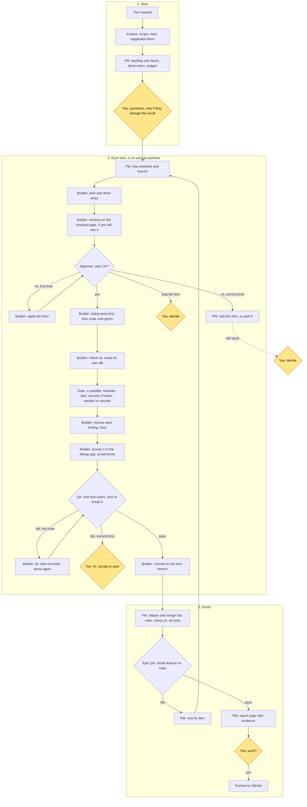

# Visor workflow

How a request becomes a pushed commit. You decide; agents do the work. `CLAUDE.md` has the hard rules.

## Skills

| Skill | Use for |
|---|---|
| `/visor-dev <request>` | One change, end to end. |
| `/visor-pm <request>` | Anything bigger: splits it into items and runs each one like `/visor-dev`, with agents. |
| `/visor-release <version>` | Shipping a version. Stops twice for you: review, then ship. |

## The flow

Yellow boxes are the only places you are asked. A plan gets two tries with the approver and a build gets two tries with QA; after that the item is split, parked or brought to you. Items that only change logic (nothing to see) skip their own QA; the epic QA covers them. Small items skip the approver and the gate.

## Who does what

| Agent | Job | Sees |
|---|---|---|
| visor-analyst | Breaks a request into items | The request |
| visor-builder | Plans, codes and proves one item in its own git worktree | The item and its plan |
| visor-approver | Accepts or rejects a plan | The request and the plan |
| visor-reviewer | Finds bugs in the diff | The diff and the rules |
| visor-perf | Checks CPU and memory | The diff and the running debug app |
| visor-qa | Tests the app like you would and tries to break it | Only the request and what "done" means, never the code |

All agents except the builder are read-only. Only the main session starts agents, merges and pushes.

## When you are asked

- Anything on the stop list: releases, deleting or migrating your data, approval or hook behaviour, plugin security, CLAUDE.md rules, new dependencies, anything outside the repo.
- An item still stuck after two tries and a split.
- The final report: push or not.

Nothing is pushed without your OK.

## Ground rules

- Tests first; logic lives in VisorCore.
- Idle CPU stays near 0%.
- Anything beside the notch is balanced around the camera.
- Testing uses the debug app and its own socket only, never the real one.
- Agents that use the screen (proof and QA) take turns.
- Commits use the author set in the repo's git config.
- Epic state lives in `.pm/` on one laptop (not in git).

## Files

- Skills: `.claude/skills/visor-dev`, `visor-pm`, `visor-release`
- Agents: `.claude/agents/visor-*.md`
- Epic state: `.pm/<epic>/` (backlog, plans, evidence, report)
